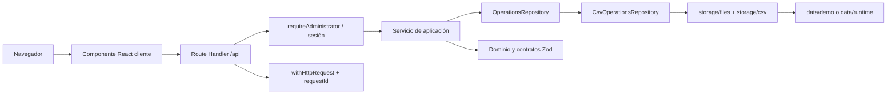

# Informe técnico maestro - Redes de Ayuda

## 1. Propósito, alcance y evidencia

Este documento describe el código vigente para que un programador o un asistente de IA pueda proponer cambios reales sin inventar arquitectura, contratos ni funcionalidades. El Markdown es la fuente principal.

Auditoría E0:

- Rama: `feature/admin-inspector`.
- Commit de partida: `e662241` (`update env_local`).
- Remoto: `https://github.com/juanhoyoss-dev-UAO/Introducci-n-ingenier-a-de-datos.git`.
- Stack comprobado: Next.js 16.4.3, React 19.3.1, TypeScript 5, Tailwind CSS 4.3.3, Zod 4.6.7, csv-parse 7.0.3, csv-stringify 6.9.0 y Vitest 5.0.5.
- Node requerido por Next.js: `>=20.9.0`; entorno auditado: Node 24.18.0 y npm 11.16.0.
- Archivos técnicos versionados inspeccionados en `src/`, `data/`, `tests/`, `scripts/` y `docs/`: 84.
- Artefactos adicionales inspeccionados: `AGENTS.md`, `README.md`, `package.json`, `package-lock.json`, `.gitignore`, `.env.example`, estructura no secreta de `.env.local` y `node_modules/next/package.json`.

El código actual es la fuente definitiva. En el commit auditado no existen `docs/ARQUITECTURA.md`, `docs/DATOS.md`, `docs/API.md`, `docs/DECISIONES.md`, `docs/ESTADO.md` ni `docs/BITACORA.md`; fueron mencionados por el encargo, pero no podían leerse. E0 crea de nuevo `ESTADO.md` y `BITACORA.md`; este informe concentra arquitectura, datos, API y decisiones comprobadas.

### 1.1 Implementado hoy

- App Router con páginas raíz, login y dashboard administrativo.
- Un administrador local, hash scrypt y sesión HMAC en cookie HttpOnly.
- Diez endpoints HTTP: cuatro públicos/de sesión y seis consultas operativas protegidas.
- Persistencia activa en snapshots CSV/JSON locales.
- Dos snapshots demostrativos independientes.
- Esquemas Zod de fila y validación integral de relaciones.
- Servicios de consulta, cálculo de indicadores y recomendaciones informativas.
- Dashboard de sólo lectura con seis pestañas y filtro por centro.
- Logger central, contexto por solicitud y `X-Request-Id`.
- Pruebas unitarias, integración CSV y HTTP real.
- Escritura interna segura de snapshots mediante `OperationsRepository.writeSnapshot`.

### 1.2 No implementado

- No hay endpoint ni pantalla para escribir o importar snapshots.
- No hay capacidad máxima, peso por paquete ni ocupación.
- No hay registro persistente de recepciones confirmadas por hora.
- No hay importación CSV/Excel, mapeo de columnas ni exportación.
- No hay gráficos, comparación visual entre jornadas ni alertas.
- No hay endpoints ni almacenamiento activo para simulaciones; sólo tipos, función pura y pruebas.
- No hay revocación individual de sesiones ni usuarios múltiples.
- No existe integración activa con Supabase, PostgreSQL o Docker.

## 2. Arquitectura general y flujo de ejecución

Next.js sirve tanto la interfaz React como los Route Handlers. Los componentes cliente nunca importan `node:fs`: obtienen JSON de `/api/*`. Los handlers autorizan y validan, los servicios coordinan casos de uso y fórmulas, el repositorio oculta la persistencia y `storage` manipula archivos.



### 2.1 Recorrido real

1. `src/app/page.tsx` redirige a `/dashboard`.
2. `src/app/dashboard/page.tsx` es un componente servidor dinámico; llama `requireAdministrator`.
3. Sin sesión válida redirige a `/login`. El login cliente usa `POST /api/auth/login`.
4. `DashboardClient` valida `/api/health`, consulta `/api/auth/me` y obtiene `/api/snapshots`.
5. Para el snapshot seleccionado dispara en paralelo detalle, centros, productos, tiempos y dashboard.
6. Cada endpoint protegido ejecuta `withAdministrator`: crea contexto de solicitud, valida la sesión y llama un servicio.
7. El servicio obtiene `OperationsRepository`; la implementación por defecto es `CsvOperationsRepository`.
8. El repositorio localiza el UUID sólo bajo las raíces permitidas y carga `metadata.json` más ocho CSV.
9. `storage/csv.ts` exige encabezado exacto; los esquemas Zod validan filas y el bundle completo valida identidad, unicidad y referencias.
10. El servicio devuelve catálogos o calcula indicadores. La respuesta usa `{ data, meta }` y recibe `X-Request-Id`.
11. Los view models convierten la respuesta en filas de tabla. Ninguna fórmula de negocio se recalcula desde el sistema de archivos en la UI.

### 2.2 Responsabilidades y fronteras

| Capa | Responsabilidad | No debe hacer |
|---|---|---|
| `src/app` | Navegación, sesión visible, estados, llamadas HTTP y presentación | Leer CSV, firmar sesiones o redefinir déficit/excedente |
| `src/contracts` | Esquemas Zod y tipos transportables | Acceder a disco o depender de React |
| `src/domain` | Fórmulas puras de inventario, eventos y traslados | Conocer HTTP, cookies o rutas físicas |
| `src/server/services` | Casos de uso, errores públicos, composición y observabilidad | Acoplarse a componentes React |
| `src/server/repositories` | Puerto de persistencia y adaptación CSV | Exponer rutas físicas a la UI |
| `src/server/storage` | Validación de encabezados, lectura/escritura y seguridad de rutas | Aplicar reglas visuales |
| `data` | Entradas versionadas y runtime local | Contener secretos o lógica |

La interfaz no debe acceder al sistema de archivos porque el navegador no tiene acceso seguro al disco del servidor; hacerlo rompería el despliegue, duplicaría validaciones, expondría rutas internas y permitiría saltarse autorización, aislamiento de snapshots y manejo uniforme de errores.

## 3. Clasificación de edición

- **LIBRE:** presentación y estilos de un módulo, siempre que no cambie contratos ni fórmulas.
- **COORDINADO:** rutas, tipos de interfaz, view models, documentación y pruebas que afectan varios consumidores.
- **PROTEGIDO:** autenticación, contratos compartidos, dominio, servicios, repositorios, almacenamiento y datos versionados.
- **GENERADO/PRIVADO:** `.next`, `node_modules`, `data/runtime`, cobertura, logs y archivos de entorno con credenciales.

Una zona visual deja de ser libre si empieza a calcular reglas de negocio, cambia el significado de un campo o modifica una respuesta HTTP.

## 4. Inventario técnico de archivos

### 4.1 App Router y frontend

| Ruta | Export principal y responsabilidad | Dependencias / consumidores | Efecto de modificar | Nivel |
|---|---|---|---|---|
| `src/app/layout.tsx` | `metadata`, `RootLayout`; HTML raíz en español y CSS global | Next Metadata, ReactNode; todas las páginas | Afecta toda la aplicación | COORDINADO |
| `src/app/globals.css` | Tailwind, colores y tipografía base | Importado por `layout.tsx` | Cambia estilo global | COORDINADO |
| `src/app/page.tsx` | `Home`; redirección servidor a `/dashboard` | `next/navigation` | Cambia entrada principal | COORDINADO |
| `src/app/login/page.tsx` | `LoginPage`; formulario cliente, detección de sesión y navegación | `/api/auth/me`, `/api/auth/login`, logger | Puede afectar acceso y UX; no debe registrar credenciales | COORDINADO |
| `src/app/dashboard/page.tsx` | `DashboardPage`, `dynamic=force-dynamic`; guard servidor | `requireAdministrator`, `DashboardClient` | Puede abrir o bloquear la consola | PROTEGIDO |
| `src/app/dashboard/dashboard-client.tsx` | `DashboardClient`; carga, abortos, pestañas, filtros, logout y tablas | Siete endpoints, tipos, view models, logger | Diseño local es libre; flujo de datos/autorización es coordinado | COORDINADO |
| `src/app/dashboard/types.ts` | Tipos de respuestas y estado de UI | Cliente y view model | Debe mantenerse alineado con respuestas reales | COORDINADO |
| `src/app/dashboard/view-model.ts` | `sortSnapshots`, `deriveSummary`, `centerRows`, `inventoryRows`, `needRows`, `volunteerRows`, `donationRows`, `travelTimeRows` | Tipos del dashboard; cliente y pruebas | Cambia filas, métricas o filtros; no debe redefinir dominio | COORDINADO |
| `src/components/.gitkeep` | Reserva un directorio sin componentes activos | Ninguno | Puede albergar componentes compartidos futuros | LIBRE inicialmente |
| `src/features/dashboard/.gitkeep` | Reserva de feature | Ninguno | No existe implementación activa allí | COORDINADO |
| `src/features/imports/.gitkeep` | Reserva de importadores | Ninguno | Importación sigue pendiente | COORDINADO |
| `src/features/simulations/.gitkeep` | Reserva de simulación | Ninguno | Simulación interactiva sigue pendiente | COORDINADO |

### 4.2 Route Handlers

| Ruta | Export / entrada | Salida y servicio | Consumidor / impacto | Nivel |
|---|---|---|---|---|
| `src/app/api/health/route.ts` | `GET(request)` | `{status:"ok"}`; sin repositorio | Bootstrap y pruebas | COORDINADO |
| `src/app/api/auth/login/route.ts` | `POST`; JSON `username/password`, mismo origen | Sesión o error; auth config/password/session | Login y suite HTTP | PROTEGIDO |
| `src/app/api/auth/logout/route.ts` | `POST`; mismo origen | Borra cookie | Dashboard | PROTEGIDO |
| `src/app/api/auth/me/route.ts` | `GET` | Estado de autenticación y usuario | Login y dashboard | PROTEGIDO |
| `src/app/api/snapshots/route.ts` | `GET` admin | Lista y total; `getSnapshots` | Dashboard | COORDINADO |
| `src/app/api/snapshots/[id]/route.ts` | `GET` admin; UUID en ruta | Metadata; `getSnapshot` | Dashboard | COORDINADO |
| `src/app/api/centers/route.ts` | `GET` admin; `snapshotId` | Centros y total; `getCenters` | Dashboard | COORDINADO |
| `src/app/api/products/route.ts` | `GET` admin; `snapshotId` | Productos con presentaciones; `getProducts` | Dashboard | COORDINADO |
| `src/app/api/travel-times/route.ts` | `GET` admin; `snapshotId` | Tiempos dirigidos; `getTravelTimes` | Dashboard | COORDINADO |
| `src/app/api/dashboard/route.ts` | `GET` admin; `snapshotId` | Indicadores agregados; `getDashboard` | Dashboard | PROTEGIDO |

### 4.3 Contratos y dominio

| Ruta | Exports / responsabilidad | Dependencias / consumidores | Riesgo | Nivel |
|---|---|---|---|---|
| `src/contracts/schemas/data.ts` | Esquemas de metadata y ocho filas, `snapshotBundleSchema`, `validateSnapshotBundle`, tipos inferidos | Zod; storage, repositorio y pruebas | Cambia el formato persistido e integridad | PROTEGIDO |
| `src/contracts/schemas/events.ts` | `confirmedReceptionPayloadSchema` y tipo | `domain/events.ts` | Contrato conceptual de simulación, no persistido | PROTEGIDO |
| `src/contracts/schemas/queries.ts` | `snapshotIdSchema`, `validateSnapshotId` | Rutas, HTTP y repositorio | Afecta todas las consultas por snapshot | PROTEGIDO |
| `src/contracts/types/api.ts` | `SuccessResponse<T>`, `ErrorResponse` | Servicio HTTP | Forma común de respuestas | PROTEGIDO |
| `src/contracts/types/database.ts` | Registros de snapshot, catálogos, operaciones y tipos conceptuales de simulación | Repositorio y servicios | Algunos tipos de simulación no tienen persistencia activa | PROTEGIDO |
| `src/domain/inventory.ts` | Conversión de paquetes, déficit, excedente y voluntarios faltantes | Dashboard y pruebas | Fórmulas centrales | PROTEGIDO |
| `src/domain/transfers.ts` | `recommendTransfers` y tipos | Dashboard y pruebas | Recomendación informativa por paquetes completos | PROTEGIDO |
| `src/domain/events.ts` | `applyConfirmedReceptions` y tipos | Sólo prueba unitaria en la versión actual | Función pura; no implica endpoint ni almacenamiento | PROTEGIDO |

### 4.4 Servidor

| Ruta | Exports / responsabilidad | Dependencias / consumidores | Consecuencia | Nivel |
|---|---|---|---|---|
| `src/server/auth/config.ts` | `getAuthConfiguration`, tipos y error | Variables de entorno, password | Cambia requisitos de autenticación | PROTEGIDO |
| `src/server/auth/password.ts` | Crear/validar/verificar hash scrypt y comparación constante | Node crypto, script y login | Criptografía y compatibilidad de hashes | PROTEGIDO |
| `src/server/auth/session.ts` | Firma/verificación HMAC, cookie, HTTPS y origen | Login/logout/me/guard/tests | Afecta todas las sesiones | PROTEGIDO |
| `src/server/auth/require-admin.ts` | `requireAdministrator` | cookies, config, session, ApiError | Frontera de autorización | PROTEGIDO |
| `src/server/observability/request-context.ts` | Contexto AsyncLocalStorage, requestId, snapshot y log | Servicio HTTP, storage y auth | Correlación de trazas | PROTEGIDO |
| `src/server/services/errors.ts` | `ApiError`, `RepositoryError` | HTTP, servicios y repositorio | Mapeo de errores públicos | PROTEGIDO |
| `src/server/services/http.ts` | `successResponse`, `parseSnapshotId`, `withHttpRequest`, `withAdministrator` | Todas las rutas | Formato, auth, códigos y requestId | PROTEGIDO |
| `src/server/services/operations.ts` | Consultas de snapshots, centros, productos y tiempos | Repositorio, rutas | Casos de uso de lectura | PROTEGIDO |
| `src/server/services/dashboard.ts` | `getDashboard` | Repositorio y dominio | Indicadores y candidatos de traslado | PROTEGIDO |
| `src/server/repositories/types.ts` | `OperationsRepository`, `DashboardSource` | Servicios e implementación CSV | Puerto central de persistencia | PROTEGIDO |
| `src/server/repositories/operations.ts` | Singleton `getOperationsRepository`, reexports | Servicios | Selecciona implementación activa | PROTEGIDO |
| `src/server/repositories/csv-operations.ts` | `CsvOperationsRepository` | storage, contratos, logger | Lectura, aislamiento y publicación | PROTEGIDO |
| `src/server/storage/csv.ts` | Parser/stringifier, columnas y nombres canónicos | `files.ts`, pruebas | Encabezados exactos y serialización | PROTEGIDO |
| `src/server/storage/files.ts` | Seguridad de rutas, lectura/escritura de bundles | Contratos, CSV, repositorio | Acceso directo al disco | PROTEGIDO |
| `src/lib/logger.ts` | Niveles, módulos, sanitización, formato y logger | UI y servidor | Puede filtrar o exponer diagnóstico | PROTEGIDO |
| `scripts/generate-admin-password-hash.mjs` | CLI interactiva para hash scrypt | Node readline/crypto | No acepta contraseña en argumentos; salida es hash | PROTEGIDO |

### 4.5 Datos, pruebas y archivos generados

| Ruta o patrón | Responsabilidad | Consumidor | Modificación | Nivel |
|---|---|---|---|---|
| `data/templates/*.csv` | Ocho encabezados canónicos sin filas | Personas/importadores futuros | Deben coincidir exactamente con `CSV_COLUMNS` | PROTEGIDO |
| `data/demo/snapshots/...001/*` | Jornada demostrativa A: metadata + ocho CSV | Repositorio y pruebas | Cambia ejemplos, resultados y pruebas | PROTEGIDO |
| `data/demo/snapshots/...002/*` | Jornada demostrativa B independiente | Repositorio, UI y pruebas | Cambia aislamiento y comparación | PROTEGIDO |
| `data/runtime/` | Snapshots, simulaciones, staging y pruebas locales | Repositorio | No versionar ni editar como fuente | GENERADO/PRIVADO |
| `tests/helpers/csv.ts` | Helpers para crear bundles/archivos de prueba | Integración CSV | Cambios afectan fixtures | COORDINADO |
| `tests/unit/auth.test.ts` | Hash, token, cookie y origen | Módulos auth | Barrera de seguridad | PROTEGIDO |
| `tests/unit/inventory.test.ts` | Conversión, déficit, donación separada, excedente y voluntarios | Dominio | Especificación ejecutable | PROTEGIDO |
| `tests/unit/transfers.test.ts` | Sentido, paquetes enteros y no mutación | Dominio | Especificación ejecutable | PROTEGIDO |
| `tests/unit/events.test.ts` | Recepción por simulación y corte temporal | Dominio conceptual | No prueba persistencia | PROTEGIDO |
| `tests/unit/logger.test.ts` | Niveles, OFF y sanitización | Logger | Evita fuga de detalles | PROTEGIDO |
| `tests/unit/dashboard-view-model.test.ts` | Orden, métricas, inventario, filtro y tiempos | View model | Protege representación | COORDINADO |
| `tests/integration/csv-repository.test.ts` | Lectura, escritura y aislamiento | Repositorio | Contrato de persistencia | PROTEGIDO |
| `tests/integration/csv-safety.test.ts` | Rutas, symlinks, duplicados y publicación | Storage/repositorio | Seguridad de archivos | PROTEGIDO |
| `tests/integration/csv-validation.test.ts` | Encabezados, filas y relaciones | Contratos/storage | Integridad del bundle | PROTEGIDO |
| `tests/http/endpoints.test.ts` | Next real, auth, endpoints, dashboard y logs | Aplicación completa | Prueba de integración más amplia | COORDINADO |
| `.env.local` | Credenciales locales | Next.js | Está versionado indebidamente; no mostrar ni distribuir | GENERADO/PRIVADO |
| `.next/`, `node_modules/`, `coverage/` | Compilación, dependencias y reportes | Herramientas | Regenerables | GENERADO/PRIVADO |

## 5. Modelo CSV/JSON implementado

### 5.1 Unidad de aislamiento

Un snapshot es un directorio cuyo nombre es un UUID canónico en minúsculas. `metadata.json.id` debe coincidir con el directorio y cada fila CSV debe repetir el mismo `snapshot_id`. Los códigos `centro_id`, `producto_id`, `sku_id` e `intencion_id` sólo son únicos dentro del snapshot.

`snapshot_id` identifica una fotografía completa e independiente. `centro_id` identifica un centro dentro de ella. `producto_id` identifica el bien y su unidad base. `sku_id` identifica una presentación física del producto con un contenido por paquete.

Metadata real:

```json
{
  "id": "10000000-0000-4000-8000-000000000001",
  "nombre": "Jornada demostrativa A",
  "created_at": "2026-10-01T08:00:00-05:00",
  "descripcion": "Dataset principal con seis centros."
}
```

- `id`: UUID.
- `nombre`: texto no vacío.
- `created_at`: fecha/hora ISO 8601 con zona.
- `descripcion`: texto o `null`.

### 5.2 Encabezados, tipos y relaciones

| Archivo | Encabezado exacto | Restricciones |
|---|---|---|
| `centros.csv` | `snapshot_id,centro_id,nombre,estado,zona,coordinador_nombre` | ID no vacío; nombre, estado y coordinador no vacíos; zona admite vacío como `null` |
| `productos.csv` | `snapshot_id,producto_id,nombre,unidad_base` | unidad: `ml`, `g` o `unidad` |
| `presentaciones.csv` | `snapshot_id,sku_id,producto_id,nombre,contenido_por_paquete` | contenido positivo; producto existente |
| `inventario.csv` | `snapshot_id,centro_id,sku_id,cantidad_paquetes` | entero no negativo; centro y SKU existentes; par centro/SKU único |
| `necesidades.csv` | `snapshot_id,centro_id,producto_id,objetivo_unidad_base,reserva_unidad_base,prioridad` | objetivo/reserva no negativos; prioridad entera 1..3; centro/producto existentes |
| `voluntarios.csv` | `snapshot_id,centro_id,disponibles,requeridos` | enteros no negativos; un registro por centro |
| `tiempos.csv` | `snapshot_id,origen_id,destino_id,minutos` | entero no negativo; ambos centros existen; par dirigido único |
| `intenciones.csv` | `snapshot_id,intencion_id,centro_id,sku_id,cantidad_paquetes,llegada_prevista,estado` | paquetes enteros positivos; timestamp con zona; estado `pendiente|recibida|cancelada`; referencias válidas |

El parser acepta números canónicos con signo y decimales donde el esquema los permita, rechaza encabezados reordenados, columnas extra/faltantes y filas mal formadas. El bundle comprueba duplicados por claves simples o compuestas y todas las referencias.

### 5.3 Datos disponibles

- Jornada A (`...001`, 2026-10-01 08:00 -05:00): 6 centros, 5 productos, 7 presentaciones, 11 inventarios, 8 necesidades, 6 voluntarios, 6 tiempos y 2 intenciones.
- Jornada B (`...002`, 2026-10-15 08:00 -05:00): 2 centros, 5 productos, 8 presentaciones, 4 inventarios, 2 necesidades, 2 voluntarios, 2 tiempos y 1 intención.
- `data/templates`: los ocho encabezados, sin metadata ni filas.
- `data/runtime/snapshots`: publicaciones locales.
- `data/runtime/.staging`: escritura temporal.
- `data/runtime/simulations`: directorio creado por el repositorio, pero sin implementación persistente de simulaciones.

### 5.4 Fórmulas

- Conversión a unidad base: `cantidad_paquetes * contenido_por_paquete`.
- Inventario confirmado: suma de esa conversión para todas las presentaciones del centro y producto.
- Déficit: `max(0, objetivo_unidad_base - inventario_confirmado)`.
- Excedente: `max(0, inventario_confirmado - objetivo_unidad_base - reserva_unidad_base)`.
- Voluntarios faltantes: `max(0, requeridos - disponibles)`.
- Donación esperada: suma separada de intenciones `pendiente`; no modifica inventario ni reduce déficit confirmado.

Ejemplo comprobado: C01 tiene 10 paquetes de 600 ml y 4 de 1500 ml, total 12000 ml. Frente a un objetivo de 20000 ml, el déficit confirmado es 8000 ml. La intención pendiente de 10 paquetes de 600 ml equivale a 6000 ml esperados, pero el déficit sigue siendo 8000 ml.

### 5.5 Lectura, validación y publicación

1. `CsvOperationsRepository.collectLocations` combina demo y runtime y rechaza UUID no canónicos, entradas no directorio, symlinks y duplicados entre raíces.
2. `readSnapshotBundle` exige directorio y nueve archivos regulares.
3. Lee metadata y ocho CSV en paralelo.
4. `parseCsvRows` valida encabezado exacto y cada fila.
5. `validateSnapshotBundle` comprueba pertenencia, unicidad y referencias.
6. Para escribir, `writeSnapshot` valida primero el objeto completo y serializa operaciones del mismo UUID mediante una cola en memoria.
7. Crea un directorio único bajo `.staging`, escribe con bandera exclusiva `wx`, relee y valida.
8. Recomprueba que el UUID no apareció y publica mediante `rename`.
9. Nunca sobrescribe un snapshot. Ante fallo elimina sólo su staging.

La cola protege un proceso Node; no es un bloqueo distribuido. Dos procesos separados podrían competir. El diseño es local y no sustituye una base de datos multiusuario.

## 6. Contratos HTTP

### 6.1 Formas comunes

Éxito:

```json
{"data":{"status":"ok"},"meta":{}}
```

Error:

```json
{"error":{"code":"INVALID_SNAPSHOT_ID","message":"El parámetro snapshotId debe ser un UUID válido.","details":{}}}
```

`details` sólo se incluye en algunos errores controlados, como validación Zod. Errores inesperados devuelven un mensaje genérico. Las respuestas instrumentadas incluyen `X-Request-Id`.

### 6.2 Inventario de endpoints

| Método y ruta | Auth / entrada | Respuesta / servicio / repositorio | Errores | Consumidor y prueba |
|---|---|---|---|---|
| `GET /api/health` | Pública | `data.status=ok`; sin servicio de negocio ni repositorio | 500 inesperado | Bootstrap; HTTP health |
| `POST /api/auth/login` | Pública; origen igual; JSON estricto `username/password` | `authenticated`, usuario, expiración y cookie; config + scrypt + sesión | 400 `INVALID_REQUEST`, 401 `INVALID_CREDENTIALS`, 403 `INVALID_ORIGIN`, 500 `AUTH_CONFIGURATION_ERROR` | Login; HTTP T01/T02/origen |
| `POST /api/auth/logout` | No exige sesión; sí origen igual | `authenticated:false`; expira cookie | 403 `INVALID_ORIGIN` | Dashboard; HTTP logout/origen |
| `GET /api/auth/me` | Pública; cookie opcional | Usuario/expiración o `authenticated:false` | 500 `AUTH_CONFIGURATION_ERROR` | Login y dashboard; HTTP sesión |
| `GET /api/snapshots` | Admin | `SnapshotRecord[]`, `meta.total`; `getSnapshots -> listSnapshots` | 401, 403, 500 | Bootstrap; HTTP auth/listado |
| `GET /api/snapshots/{id}` | Admin; UUID de ruta | Metadata; `getSnapshot -> findSnapshot` | 400 `INVALID_SNAPSHOT_ID`, 404 `SNAPSHOT_NOT_FOUND`, 401/403/500 | Carga de bundle; HTTP errores |
| `GET /api/centers?snapshotId={id}` | Admin; query UUID | Centros, snapshot y total; `getCenters -> findSnapshot/listCenters` | 400 `MISSING_SNAPSHOT_ID|INVALID_SNAPSHOT_ID`, 404, 401/403/500 | Dashboard; HTTP datos reales |
| `GET /api/products?snapshotId={id}` | Admin; query UUID | Productos con `presentaciones[]`; `getProducts -> listProducts/listPresentations` | 400, 404, 401/403/500 | Inventario/donaciones; HTTP datos |
| `GET /api/travel-times?snapshotId={id}` | Admin; query UUID | Tiempos dirigidos y total; `getTravelTimes -> listTravelTimes` | 400, 404, 401/403/500 | Pestaña tiempos; HTTP sentido |
| `GET /api/dashboard?snapshotId={id}` | Admin; query UUID | Snapshot, centros enriquecidos, donaciones y candidatos; `getDashboard -> getDashboardSource` | 400, 404, 401/403/500 | Métricas y cuatro pestañas; HTTP D0 |

Un `RepositoryError` se traduce actualmente a código HTTP 500 con código público histórico `DATABASE_ERROR`, aunque la persistencia activa ya no es una base de datos. No cambiar ese código sin revisar consumidores y pruebas.

### 6.3 Sesión y autorización

- Cookie: `redes_ayuda_session`.
- Token: payload JSON base64url + firma HMAC-SHA256.
- Claims: versión 1, sujeto, rol, emisión y expiración.
- Vigencia máxima: cuatro horas.
- Atributos: `HttpOnly`, `SameSite=Lax`, ruta `/`, `Secure` bajo HTTPS.
- Login/logout rechazan solicitudes sin `Origin` válido o con origen distinto del host.
- `requireAdministrator` devuelve 401 sin sesión y 403 si rol/sujeto no coinciden con la configuración.
- No existe almacén central de sesiones ni revocación individual; rotar `SESSION_SECRET` invalida todas.

## 7. Arquitectura del frontend

### 7.1 Páginas

- `/`: redirige a `/dashboard`.
- `/login`: componente cliente. Consulta sesión existente; envía credenciales; nunca registra usuario/contraseña.
- `/dashboard`: componente servidor dinámico. Valida administrador antes de renderizar el cliente.
- `DashboardClient`: recibe el usuario validado, mantiene estado y compone datos de varios endpoints.

### 7.2 Carga y consistencia

El bootstrap consulta health, sesión y snapshots. `sortSnapshots` ordena de forma ascendente por `created_at` y luego por ID; el primer snapshot es la selección inicial. Al cambiar de snapshot:

- valida que el ID esté en la lista;
- limpia bundle, filtro y error;
- cancela el grupo anterior con `AbortController`;
- solicita cinco recursos del mismo UUID;
- comprueba que cada respuesta corresponde al ID solicitado antes de publicar el bundle.

Los estados explícitos son `bootstrapping`, `loading`, `loggingOut`, `error`, `reloadToken`, snapshot, centro, pestaña y bundle. Hay mensajes de carga, vacío, error recuperable y botón Reintentar.

### 7.3 Seis secciones

| Sección | Fuente | Transformación |
|---|---|---|
| Centros | `/api/centers` | `centerRows` filtra por centro |
| Inventario | Productos + `dashboard.centros[].productos[].existencias` | `inventoryRows` une SKU/nombre y calcula sólo subtotal visual; total confirmado viene del backend |
| Necesidades | `dashboard.centros[].productos` | `needRows` conserva objetivo, confirmado, déficit y prioridad |
| Voluntarios | `dashboard.centros[].voluntarios` | `volunteerRows` aplana por centro |
| Donaciones esperadas | `dashboard.donaciones_esperadas` + catálogos | `donationRows` une centro/SKU y presenta total anunciado aparte |
| Tiempos | `/api/travel-times` | `travelTimeRows` incluye origen o destino cuando hay filtro |

Las seis tarjetas resumen usan `deriveSummary`: centros, productos, presentaciones, centros con objetivo, centros con déficit y número de intenciones anunciadas.

### 7.4 Guía de ampliación

| Objetivo | Archivos mínimos | Requiere backend |
|---|---|---|
| Cambiar diseño general | `dashboard-client.tsx`, `globals.css` | No, si no cambia significado |
| Añadir tarjeta con dato ya presente | `view-model.ts`, tipos, cliente y prueba | No |
| Añadir tarjeta con cálculo nuevo | Contrato/dominio/servicio/API, tipos y UI | Sí |
| Crear nueva pestaña con datos existentes | `types.ts`, `view-model.ts`, `dashboard-client.tsx`, prueba | No o coordinado |
| Incorporar gráfico de datos existentes | Componente nuevo y view model; evitar dependencia sin aprobación | No |
| Agregar filtro | Cliente + función pura + prueba | Sólo si el filtro debe ejecutarse en servidor |
| Mostrar campo ya devuelto | Tipos, view model y tabla | No |
| Mostrar campo no devuelto | Contrato, repositorio/servicio/endpoint, tipos y UI | Sí |
| Consumir endpoint adicional | Tipos, `fetchApi`, ciclo de carga/abortos y UI | Sí si el endpoint no existe |

## 8. Persistencia, seguridad y observabilidad

### 8.1 Seguridad de archivos

- `resolveWithin` impide salir de una raíz mediante `..` o rutas absolutas.
- Se rechaza ubicar almacenamiento bajo `public/`.
- Cada componente existente de una ruta se inspecciona para rechazar symlinks.
- Directorios y archivos deben ser reales, no enlaces.
- Los UUID de directorio deben ser canónicos.
- Escritura usa `wx`, staging, relectura y rename; no sobrescribe.
- `data/runtime/` está ignorado por Git.

### 8.2 Riesgo crítico de entorno

La auditoría comprobó sin leer valores que `.env.local` está versionado, no está ignorado y contiene valores no vacíos para `ADMIN_USERNAME`, `ADMIN_PASSWORD_HASH` y `SESSION_SECRET`. El commit que lo introdujo es `e662241`.

Decisión pendiente del líder:

1. Rotar contraseña/hash y secreto.
2. Añadir reglas de ignore para `.env*` conservando `.env.example`.
3. Ejecutar `git rm --cached .env.local`.
4. Crear un commit de saneamiento antes de entregar la base.
5. No copiar secretos al chat, documentación o ramas.

E0 no hizo esa mutación ni reescribió historial.

### 8.3 Supabase

No hay dependencias, imports, variables requeridas ni módulos activos de Supabase en el árbol actual. Si existió integración, sólo puede considerarse histórica hasta revisar Git; no forma parte de la ejecución vigente.

### 8.4 Logging y requestId

`withHttpRequest` crea un contexto AsyncLocalStorage con UUID local. `serverLog` añade `requestId`, método, ruta y snapshot conocido. Las capas emiten módulos `AUTH`, `API`, `SERVICE`, `REPOSITORY` y `UI` con niveles `INFO`, `OK`, `WARN`, `ERROR`.

El logger:

- elimina detalles cuyas claves parezcan password, secret, token, cookie, authorization o hash;
- limita y normaliza texto;
- resume arrays/objetos y no serializa errores completos;
- usa `APP_LOG_LEVEL` en servidor y `NEXT_PUBLIC_APP_LOG_LEVEL` en cliente;
- no persiste logs.

Para rastrear un fallo, copie `X-Request-Id` desde Network y búsquelo en la terminal. Después siga el orden API -> AUTH -> SERVICE -> REPOSITORY -> resultado.

## 9. Pruebas y diagnóstico

### 9.1 Suites

| Comando | Objetivo | Resultado E0 |
|---|---|---|
| `npm.cmd run test:unit` | Seis archivos: auth, inventario, traslados, eventos, logger y view model | 22/22 aprobadas |
| `npm.cmd run test:csv` | Tres archivos: repositorio, seguridad y validación | 25/25 aprobadas |
| `npm.cmd run test:http` | 14 casos contra Next real con credenciales y datos temporales | No aprobado en E0: servidor principal activo bloqueó ejecución normal; en copia aislada 13/14 y luego 12/14, con timeouts de 5 s |
| `npm.cmd run lint` | ESLint completo | Aprobado |
| `npm.cmd run typecheck` | TypeScript sin emitir | Aprobado |
| `npm.cmd run build` | Build Next.js webpack | Aprobado; 13 rutas/páginas |

La suite HTTP no produjo fallos de aserción funcional en E0: agotó el tiempo durante solicitudes de dashboard/login en el entorno aislado. Esto no se registra como aprobada. La prueba había aprobado 14/14 en la entrega D0, pero ese resultado histórico no sustituye la ejecución actual.

### 9.2 Cobertura y vacíos

Cubierto:

- fórmulas puras;
- firma/verificación de sesión y origen;
- sanitización del logger;
- encabezados, tipos, referencias y aislamiento;
- publicación sin sobrescritura y seguridad de rutas;
- endpoints, auth, valores demostrativos y correlación de logs;
- view models y prevención de mezcla representativa.

No cubierto de forma específica:

- accesibilidad completa y pruebas de componentes React en DOM;
- rendimiento con snapshots grandes;
- concurrencia entre varios procesos;
- Windows con múltiples servidores Next simultáneos;
- importaciones, capacidad, recepciones horarias y gráficos, porque no existen;
- revocación individual y rotación automatizada de secretos.

Ejecutar una prueba específica:

```powershell
npx.cmd vitest run tests/unit/inventory.test.ts
npx.cmd vitest run tests/integration/csv-validation.test.ts
```

Diagnóstico:

1. UI: F12 -> Console; busque `[UI]`.
2. HTTP: F12 -> Network; revise status, JSON y `X-Request-Id`.
3. Servicio/repositorio: busque el mismo requestId en terminal.
4. CSV: el mensaje interno identifica archivo/fila; la API devuelve error genérico para no filtrar rutas.
5. Compilación: ejecute primero typecheck y lint; corrija el primer error causal.

## 10. Plan técnico de ampliaciones - no implementado en E0

### 10.1 A. Capacidad máxima de centros

Modelo propuesto:

- Añadir `capacidad_max_kg` a `centros.csv`: número positivo por centro.
- Añadir `peso_kg_por_paquete` a `presentaciones.csv`: número positivo por SKU.
- Mantener `contenido_por_paquete` y `unidad_base` sin reinterpretarlos.
- Peso almacenado: `sum(cantidad_paquetes * peso_kg_por_paquete)`.
- Capacidad libre: `max(0, capacidad_max_kg - peso_almacenado_kg)`.
- Ocupación: `peso_almacenado_kg / capacidad_max_kg * 100`.

No se puede convertir automáticamente `ml` o `unidad` a kg. Los pesos de demostración deben ser ficticios, coherentes, explícitos y revisados.

Impacto:

1. Datos: encabezados de centros/presentaciones, templates y cada snapshot.
2. Contratos: `centerCsvRowSchema`, `presentationCsvRowSchema`, tipos de database y UI.
3. Repositorio/storage: `CSV_COLUMNS`, serialización y pruebas de encabezado.
4. Dominio: funciones puras de peso, capacidad libre, porcentaje y umbrales.
5. Servicio: añadir agregados al dashboard, no calcularlos en React.
6. HTTP: ampliar respuestas existentes; no hace falta un endpoint nuevo si se devuelve por centros/dashboard.
7. UI: tarjeta, columnas y alertas; gráficos sólo después de validar unidades.
8. Pruebas: decimales, cero/no válido, sobrecapacidad, varias presentaciones y aislamiento.
9. Migración: crear versión nueva de cada snapshot o un importador con valor explícito. No asumir un valor por defecto silencioso; los snapshots antiguos deben migrarse antes de pasar a un esquema obligatorio.

### 10.2 B. Recepciones confirmadas por hora

Las intenciones anunciadas y las recepciones reales son entidades distintas. Modelo mínimo propuesto, aún inexistente:

```text
recepcion_id
snapshot_id o jornada_id
centro_id
sku_id
cantidad_paquetes_recibidos
fecha_hora_recepcion
intencion_id (opcional)
```

Reglas:

- `recepcion_id` único dentro de la jornada; si llegan fuentes externas, añadir `source_id` o clave idempotente.
- `centro_id` y `sku_id` deben pertenecer a la misma jornada.
- `cantidad_paquetes_recibidos` es entero positivo.
- `fecha_hora_recepcion` usa ISO 8601 con offset `-05:00` y semántica `America/Bogota`.
- `intencion_id` es opcional y, si aparece, debe existir en la jornada.
- La hora agrupada es 0..23 tras convertir explícitamente a `America/Bogota`.
- Una recepción puede existir sin intención; la hora prevista nunca reemplaza la real.
- Para evitar duplicados, rechazar la misma clave idempotente/recepción y no inferir recepción desde una intención.
- Para aislar jornadas, toda consulta y clave debe incluir snapshot/jornada.
- No sumar recepciones otra vez sobre un snapshot cuyo inventario ya representa el cierre posterior; definir un corte temporal único.

Consultas futuras:

- conteo de recepciones por día/hora;
- paquetes recibidos por día/hora;
- suma en unidad base por centro/producto;
- hora pico por conteo y por paquetes, claramente diferenciadas.

Impacto previsto: nuevo CSV y esquema Zod, tipos, métodos de repositorio, storage, servicio de agregación, endpoints de lectura/escritura autorizados, view model, pestaña/gráfico y pruebas de zona horaria, duplicado, referencia y doble conteo. La función `applyConfirmedReceptions` es una referencia conceptual, no almacenamiento listo.

### 10.3 C. Jornadas 1, 2 y 3

Disponible hoy:

- dos snapshots independientes;
- `metadata.created_at` con offset;
- listado, selección y aislamiento;
- publicación interna segura mediante `writeSnapshot`;
- UI para ver una jornada a la vez.

Pendiente:

- datos aprobados para una tercera jornada;
- endpoint o CLI de publicación;
- comparación entre snapshots;
- normalización de catálogos entre jornadas;
- gráficos de evolución;
- integración explícita de recepciones.

Procedimiento futuro:

1. Definir `created_at` como cierre de jornada y documentar la zona.
2. Copiar templates a un directorio de preparación fuera de los snapshots publicados.
3. Asignar UUID nuevo y repetirlo en metadata y todas las filas.
4. Crear datos completos de la jornada 2/3; el inventario debe ser el estado de esa jornada, no la suma de inventarios completos anteriores.
5. Validar encabezados, relaciones y unicidad con `snapshotBundleSchema`.
6. Publicar mediante `writeSnapshot`, no copiando sobre un UUID existente.
7. Ordenar cronológicamente por `created_at` y usar ID como desempate.
8. Para comparar, unir por IDs de negocio sólo después de verificar que representan el mismo centro/producto entre jornadas; mostrar faltantes/nuevos explícitamente.
9. Variación: `valor_jornada_actual - valor_jornada_anterior`; no mezclar unidades.
10. Integrar recepciones sólo si existe fuente confirmada y ventana temporal compatible con el corte.

## 11. Decisiones y riesgos pendientes

| Prioridad | Tema | Estado / decisión necesaria |
|---|---|---|
| Crítica | `.env.local` versionado con valores no vacíos | Retirar del índice y rotar antes de entregar a compañeros |
| Alta | Suite HTTP sensible a servidor activo y timeout de 5 s | Ejecutar en checkout limpio sin otro `next dev`; evaluar timeout de arranque sin ocultar fallos |
| Alta | Documentos históricos ausentes | Este informe reemplaza la referencia; decidir si se restauran documentos separados |
| Media | Tipos de API duplicados en frontend | Mantener alineados o definir contrato compartido con revisión |
| Media | Código conceptual de simulación sin persistencia/API | No presentarlo como funcionalidad disponible |
| Media | Código público `DATABASE_ERROR` con backend CSV | Mantener por compatibilidad hasta decisión coordinada |
| Media | Bloqueo de escritura sólo por proceso | No usar para concurrencia distribuida |
| Baja | Sin pruebas de componentes/accesibilidad | Añadir cuando comience evolución visual |

## 12. Orden de lectura y entrega

Para un compañero principiante o una IA:

1. [README](../README.md): instalación, ejecución y diagnóstico.
2. [Contexto para IA](CONTEXTO_IA.md): límites y forma de trabajo.
3. Este informe: arquitectura, contratos y riesgos.
4. [Catálogo técnico](CATALOGO_TAREAS_TECNICAS.md): seleccionar una misión.
5. [Reglas de negocio](REGLAS_NEGOCIO.md): fórmulas que no deben duplicarse.
6. Código vigente y pruebas relacionadas con la tarea.

La documentación orienta, pero no sustituye volver a abrir los archivos reales antes de editar.
