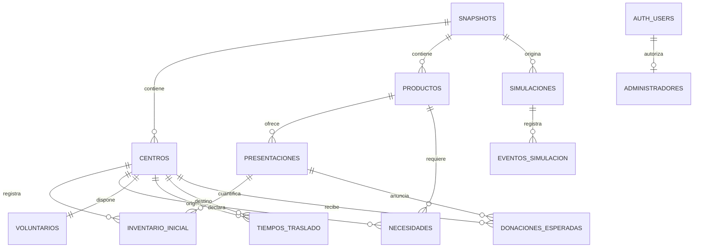

# Modelo entidad-relación

## Alcance

El modelo del Bloque B usa once entidades funcionales y una tabla técnica de administradores. Todos los datos operativos quedan ligados directa o indirectamente a un snapshot. Los identificadores de negocio, como `C01`, solo son únicos dentro de su snapshot.

## Entidades y restricciones

| Entidad | Clave primaria | Relaciones y controles principales |
| --- | --- | --- |
| `snapshots` | `id` UUID | Nombre obligatorio y fecha de creación. |
| `centros` | `snapshot_id, centro_id` | FK a snapshot; nombre, estado y coordinador obligatorios. |
| `productos` | `snapshot_id, producto_id` | Unidad base limitada a `ml`, `g` o `unidad`. |
| `presentaciones` | `snapshot_id, sku_id` | FK compuesta al producto del mismo snapshot; contenido positivo. |
| `inventario_inicial` | `snapshot_id, centro_id, sku_id` | FKs compuestas a centro y presentación; paquetes enteros no negativos. |
| `necesidades` | `snapshot_id, centro_id, producto_id` | FKs compuestas; objetivo y reserva no negativos; prioridad entre 1 y 3. |
| `voluntarios` | `snapshot_id, centro_id` | Una fila por centro; conteos enteros no negativos. |
| `tiempos_traslado` | `snapshot_id, origen_id, destino_id` | Dos FKs compuestas a centros del snapshot; minutos no negativos y direccionales. |
| `donaciones_esperadas` | `snapshot_id, intencion_id` | FKs compuestas a centro y presentación; paquetes positivos; estado controlado. |
| `simulaciones` | `id` UUID | FK al snapshot; `hora_actual` no puede preceder a `hora_inicio`. |
| `eventos_simulacion` | `id` UUID | FK a simulación; tipo controlado; tiempos de ocurrencia y registro separados; payload JSON objeto. |
| `administradores` | `user_id` UUID | FK a `auth.users`; tabla técnica utilizada por autorización y RLS. |

## Aislamiento

Las relaciones hacia centros, productos y presentaciones incluyen `snapshot_id`. Por ello PostgreSQL rechaza, por ejemplo, un inventario del snapshot A que intente usar un SKU exclusivo del snapshot B. La presencia aislada de una columna `snapshot_id` no sustituye estas claves foráneas compuestas.

## Índices

Las claves primarias crean sus índices automáticamente. Los índices adicionales cubren únicamente claves foráneas y consultas de esta etapa: producto de una presentación, SKU de inventario, producto de necesidad, destino de traslado, centro/SKU de donación, snapshot de simulación y secuencia temporal de eventos.

